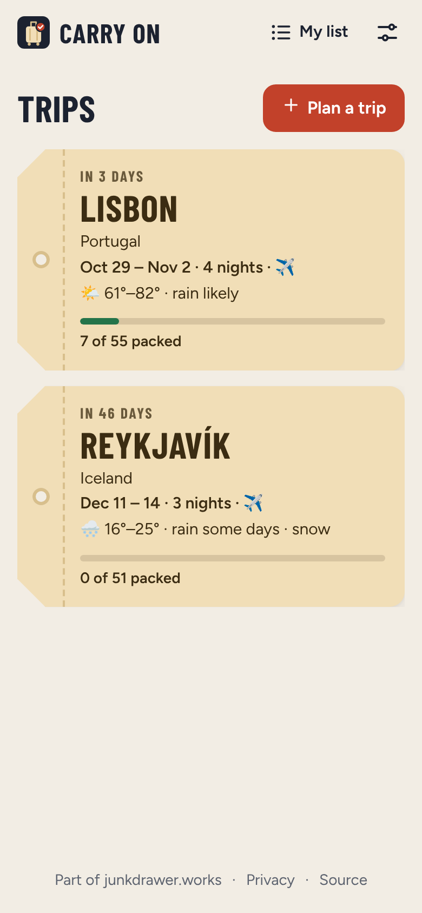
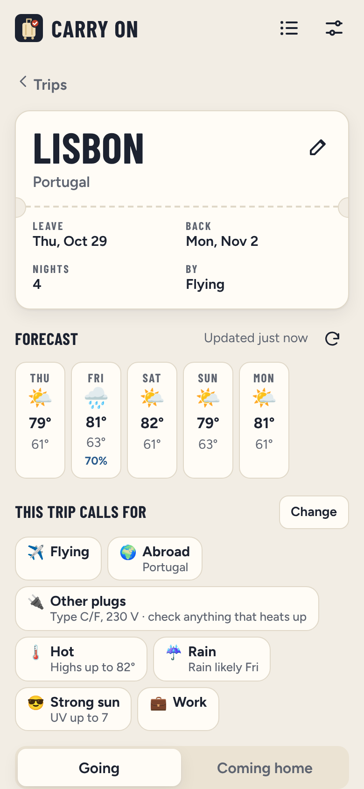
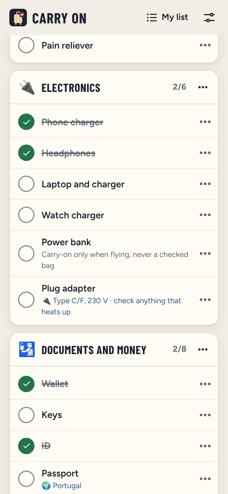
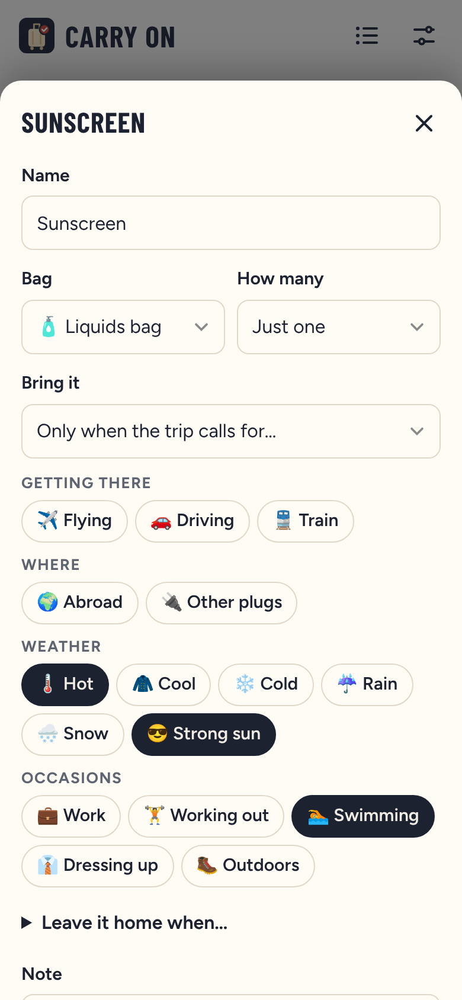

# Carry On

**Use it: [carry-on.junkdrawer.works](https://carry-on.junkdrawer.works/)**

**A packing list that knows the trip.** Keep everything you might pack in one list, sorted by the bag it goes in. Each trip gets its own fresh copy, matched to the forecast, where you're going and what you'll be doing, so there's nothing to uncheck afterwards. When it's time to come home, a second pass makes sure nothing stays behind at the hotel.

<p align="center">
  
  &nbsp;
  
  &nbsp;
  
  &nbsp;
  
</p>

## How it works

- **One list, by bag.** Your list is grouped the way you pack: the liquids bag, the toiletries bag, electronics, the backpack, the suitcase. There are also two lists of jobs, one for leaving the house and one for leaving the hotel. Move, rename and reorder anything in **My list**. A row of the bags' icons near the top of a trip, and of My list, goes straight to any of them; on a trip, each says how much of it is packed. A trip you've started packing opens at its list.
- **Every trip starts fresh.** Planning a trip makes a new copy of the list for it, so ticks belong to that trip. Old trips stay as they were, and **Go again** starts a new one from an old one.
- **It reads the forecast.** For the next 16 days, today included, it uses the forecast. Further off, it uses what the same dates were like in each of the last three years, and it switches over as the trip gets closer. If a refresh can't get a new forecast, the last one stays for up to a day, saying when it's from. Hot, cool, cold, rain, snow and strong sun (a UV index of 6 or more, which for days past the forecast is estimated from how high the sun gets there and how sunny those days were) each bring their own things: an umbrella when rain is likely on a given day, a coat when the lows are near freezing.
- **It knows where you're going.** Abroad brings your passport (from the US, Puerto Rico and the other territories count as home, apart from American Samoa). Where home is comes from the browser's language until you set it, and planning a trip shows the guess. A plug adapter comes only where your plugs don't fit the sockets, with the socket types and voltage on the list (US plugs fit in Japan and Mexico, not in Portugal). Where only some of your plugs fit, the Abroad line says which (a German grounded plug in Switzerland), and the adapter is yours to add.
- **One place or several.** A trip can go on from one place to the next: **Add a stop**, with the night you get there. Each place's weather counts for its own days, the passport comes when any of them is abroad, and the plug adapter names each country whose sockets your plugs don't fit (London then Paris: type G and type C/E).
- **And what you'll be doing.** Pick occasions for a trip (work, working out, swimming, dressing up, outdoors, or your own), and things or whole bags come along only for them: the work bag on work trips, the swimsuit when you're swimming or it's hot.
- **Says why.** Anything that came along for a reason says so under its name ("Rain likely Fri", "Type C/F, 230 V"). **Left off this trip** lists everything that didn't, and why, with a button to pack it anyway. You can also turn any weather or place condition on or off by hand. Change a trip (its place, dates or what it calls for) and it says what's on the list now and what's off, once the new forecast is in.
- **Leave things off one trip.** A single thing or job, a whole bag, or a list of jobs (no house jobs when someone's staying home) can be left off one trip from its ⋯ menu. It waits under **Left off this trip**, and stays on your list for other trips.
- **Counts by the day.** Socks and underwear come one for each day of the trip, up to a laundry limit you set. If a trip gets longer, socks ticked for the shorter one come unticked.
- **Coming home.** Switch to **Coming home** and the list starts with the hotel checklist, then shows only what you packed, with its own ticks. Something you got on the trip can go on it there too.
- **Hands full.** While you pack, each tick keeps the phone's screen from locking until three minutes after the last one, where the browser allows it (the Screen Wake Lock API).
- **Bring your own list.** Paste a list from Google Keep, Notes or a document. Bags are the lines with things under them, or headings (`Toiletries:`, `# Toiletries`); a count like "Socks x5" becomes how many to pack; and it makes a first guess at when each thing is needed (passport when abroad, swimsuit for swimming), shown before it comes in. A list can also go to someone else as a link; the list travels inside the link itself. Adding one to yours skips what you have already, and using one instead keeps your trips' ticks for things on both.
- **On every device, if you like.** Turn on Google Drive in Settings and the list, the trips, their ticks and your settings (home, °F or °C, laundry) are kept in a "Carry On" folder in your own Drive, merged thing by thing, so two phones can pack the same trip. Hide done, folded bags and whether a trip is showing Going or Coming home stay on each device, the last of those for the day it's picked: from its last day on, a trip opens on Coming home. Without Drive, everything stays in this browser.
- No account and no server. It works offline once opened and installs to a phone's home screen.

Weather and place search come from [Open-Meteo](https://open-meteo.com/). Looking up a trip sends each of its places, and its dates, there and nothing else. Plug types are from the IEC's list of world plugs. To stop Drive saving everywhere, remove junkdrawer.works under **Third-party apps & services** in your Google Account.

## Running it

It's a static site: plain HTML, CSS and JavaScript, with no build step.

```sh
npx serve .                   # or any static file server, then open the printed address
npm test                      # unit tests, then the whole app in Chromium (needs Playwright)
node tools/screenshots.mjs    # redraws docs/*.png and og.png
node tools/make-icons.mjs     # redraws the PNG icons from icon.svg
npm install && npm run build  # dist/carry-on.html, the whole app in one file
```

To put it online with GitHub Pages: **Settings → Pages → Build and deployment → Deploy from a branch**, then pick `main` and `/ (root)`. The `CNAME` file serves it at carry-on.junkdrawer.works.

### Files

- `js/model.js`: the list and trips, and how two copies merge (bag by bag, thing by thing, tick by tick).
- `js/rules.js`: where a trip is each day, what it calls for, and so what goes on its list.
- `js/weather.js`: place search, the forecast, typical weather, and what counts as hot, cold or rainy.
- `js/days.js`: dates, nights and weekdays.
- `js/plugs.js`: plug types and voltage by country, and which plugs fit which sockets.
- `js/share.js`: list links, pasted lists, and the first guesses at when things are needed.
- `js/starter.js`: the list someone starts with.
- `js/store.js`, `js/sync.js`: saving in the browser, and to Google Drive.
- `js/app.js`, `js/ui.js`, `css/app.css`: the page.
- `fonts/`: Barlow Condensed and Figtree (SIL Open Font License), served from here so nothing loads from elsewhere.
- `sw.js`: keeps a copy for using offline.
- `tools/`: `build.mjs` makes the one-file copies, `dist/carry-on.html` and `dist/artifact.html` (the one published as a Claude Artifact); `screenshots.mjs` redraws `docs/*.png` and `og.png`; `make-icons.mjs` redraws the PNG icons.
- `test/`: unit tests, the browser test, and stand-ins for Open-Meteo and Google Drive.
